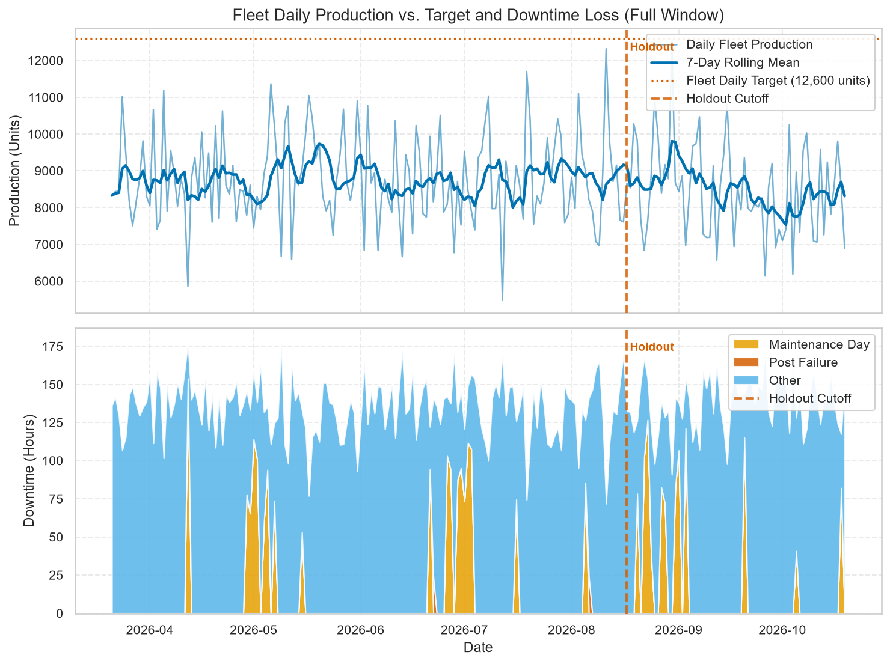
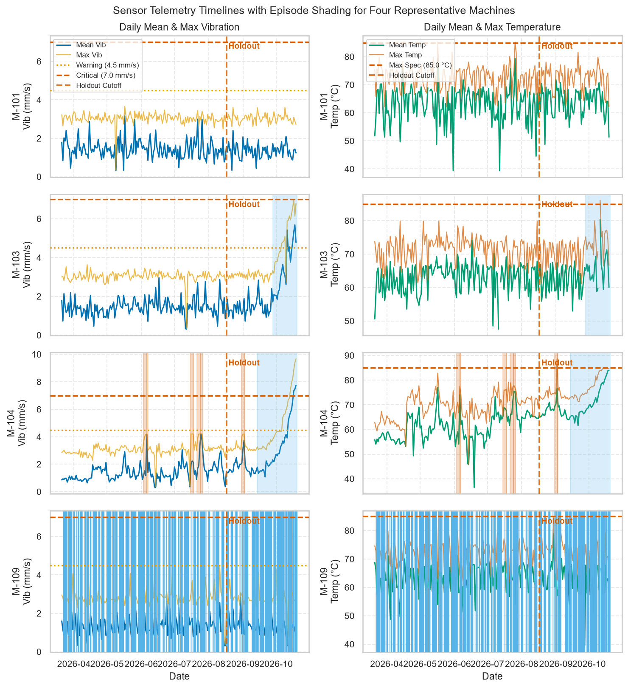
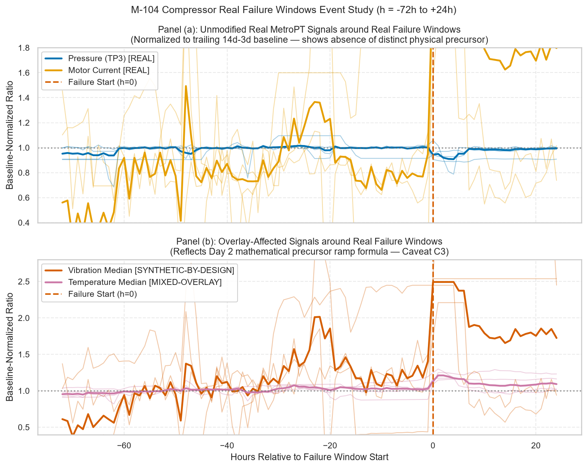

# AI Operations Intelligence Platform

An enterprise-grade operational intelligence platform combining real-time anomaly detection, predictive maintenance, demand forecasting, automated root-cause analysis, and an interactive RAG-powered knowledge copilot.

---

## Architecture Overview

```
                               ┌────────────────────────────────┐
                               │  Smart Factory Fleet(12 M/Cs) │
                               └──────────────┬─────────────────┘
                                              │
                    ┌─────────────────────────┼─────────────────────────┐
                    ▼                         ▼                         ▼
        ┌───────────────────────┐ ┌───────────────────────┐ ┌───────────────────────┐
        │   Plant A (Air Comp)  │ │ Plant B (Hyd. Press)  │ │ Plant C (Conv. Drive) │
        │   M-101 .. M-104      │ │ M-105 .. M-108        │ │ M-109 .. M-112        │
        └───────────┬───────────┘ └───────────┬───────────┘ └───────────┬───────────┘
                    │                         │                         │
                    └─────────────────────────┼─────────────────────────┘
                                              ▼
                         ┌────────────────────────────────────────┐
                         │ Unified Operational Data Layer (Raw)   │
                         │  - machines.csv (12 fleet units)       │
                         │  - sensors_raw.csv (736,128 intervals) │
                         │  - maintenance_raw.csv (43 work orders)│
                         │  - production_raw.csv (2,556 days)     │
                         │  - business_daily_raw.csv (213 days)   │
                         │  - business_transactions_raw.csv       │
                         │  - ai4i_state_raw.csv (10k rows)       │
                         └────────────────────┬───────────────────┘
                                              ▼
                         ┌────────────────────────────────────────┐
                         │ Day 3 Feature Store & Cleaning Engine  │
                         │  - sensors.parquet (Tier 1 & Tier 2)   │
                         │  - sensor_features.parquet (89 feats)  │
                         │  - operations_dataset.parquet & .csv   │
                         │  - anomaly_eval_labels.parquet         │
                         │  - business_features_daily.parquet     │
                         │  - product_demand_daily.parquet        │
                         └────────────────────┬───────────────────┘
                                              ▼
                    ┌───────────────────────────────────────────────────┐
                    │ PostgreSQL 16 Relational Schema / SQLAlchemy 2.0  │
                    └───────────────────────────────────────────────────┘
```

---

## Quickstart & One-Command Data Flow

The complete data engineering and ingestion workflow can be executed with a single command:

```bash
# Complete end-to-end data build: prepare raw, run Day 3 pipeline, load database
make data
```

### Modular Pipeline Targets

```bash
# 1. Fast sample run (machines M-103 & M-104, trailing 45 days, ~10s runtime)
make pipeline-sample

# 2. Full fleet pipeline (12 machines, 214 days, outputs all 14 processed files)
make pipeline

# 3. Load processed data into PostgreSQL database via atomic COPY transaction
make db-load

# 4. Verify output raw datasets against integrity constraints
make validate-raw

# 5. Run full test suite (31 unit, integration, leakage, and EDA tests)
make test

# 6. Run linting and code quality checks
make lint

# 7. Execute all 6 EDA notebooks top-to-bottom
make eda-run

# 8. Run EDA helper test suite
make eda-test

# 9. Strip outputs from EDA notebooks (pre-commit hygiene)
make eda-strip
```

### Python CLI Invocations

```bash
# Activate Python 3.11+ virtual environment
# Windows: .\.venv\Scripts\Activate.ps1 | Linux/macOS: source .venv/bin/activate

# Run pipeline in sample mode
python scripts/run_pipeline.py --sample --skip-db

# Run full fleet pipeline
python scripts/run_pipeline.py --skip-db

# Database loader (dry-run mode)
python scripts/load_to_db.py --dry-run
```

---

## Exploratory Data Analysis & Modeling Foundation (Day 4)

Exploratory Data Analysis (EDA) on Day 4 rigorously characterized the multi-tiered dataset, separating genuine physical telemetry from algorithmic generator artifacts to establish unbiased baselines for Days 5, 6, and 8.

All modeling decisions, operational threshold proposals, and baseline benchmarks are derived strictly from the **Exploration Partition** (first 70% of days; 150 days ending `2026-08-17 00:00 UTC`), preserving the final 30% holdout window for out-of-time evaluation ([Decision D44](docs/architecture.md#d44-chronological-7030-exploration-vs-holdout-partitioning)).

### Key Findings & Empirical Benchmarks

1. **Telemetry Reliability [REAL]:** Complete 214-day temporal span across 12 machines (736,128 5-minute intervals). Zero Tier 1 physical hard range violations and only 1 interpolated interval (0.0001% missingness rate).
2. **Failure Signatures [REAL vs. SYNTHETIC-BY-DESIGN]:** Event study on compressor `M-104` reveals that unmodified real-world telemetry (`pressure`, `motor_current`, `comp_state`) shows flat baseline trajectories prior to real failures, whereas synthetic overlays ramped artificially (+60% vibration). Day 5 anomaly models must evaluate real-only features separately from overlay-affected features ([DEC-03](docs/eda_findings.md#9-decision-register-for-days-5-6-and-8)).
3. **Throughput & Downtime Sensitivity [SYNTHETIC-BY-DESIGN]:** Daily factory output averages 8,689 units against a 12,600-unit target. Production volume is almost perfectly sensitive to downtime ($r = -0.9991$), losing 0.41 units/min on compressors, 0.82 on presses, and 1.64 on conveyors.
4. **Forecasting Benchmark to Beat [REAL/SYNTHETIC-BY-DESIGN]:** Rolling-origin 7-day ahead forecast evaluation across the 28-day exploration validation slice establishes **7-Day Moving Average (MA-7)** as the primary baseline to beat for fleet production: **MAE = 1,026.8 units (11.5% MAPE)**.
5. **AI4I Classification Governance [SYNTHETIC-BY-DESIGN]:** UCI AI4I failure prevalence in the 8,000-row training partition is exactly 3.39% (PR-AUC baseline = 0.0339; majority accuracy = 96.61%). A simple depth-2 decision tree on `strain` and `power_w` achieves 85.2% precision, confirming rule-generated label dynamics. Target leakage columns (`twf`, `hdf`, `pwf`, `osf`, `rnf`, `udi`, `product_id`) must be strictly excluded on Day 6.

### Key Visualizations

#### Fleet Production & Downtime Decomposition

*Figure 1: Daily fleet production vs. 12,600-unit target with 7-day moving average (top panel), and daily downtime hours categorized by maintenance, post-failure, and operational causes (bottom panel).*

#### Diagnostic Sensor Timelines Across Four Regimes

*Figure 4: Full 7-month telemetry timelines of daily mean and max vibration and temperature across healthy (M-101), linear drift (M-103), hero degrading (M-104), and benign spike (M-109) regimes.*

#### Compressor Failure Event Study: Real Signals vs. Synthetic Overlay

*Figure 7: Event study (-72h to +24h) contrasting unmodified real-world sensor channels showing flat baseline behavior (top panel) with synthetic overlay-affected channels showing artificial warning ramps (bottom panel).*

### Reproducible Notebooks (`ml/notebooks/`)

- [`01_overview_and_lineage.ipynb`](ml/notebooks/01_overview_and_lineage.ipynb): Dataset dimensions, quality audit, lineage matrix, and planted-effects recovery (EQ1–EQ5).
- [`02_production_downtime_energy.ipynb`](ml/notebooks/02_production_downtime_energy.ipynb): Throughput, downtime drivers, energy efficiency, and inventory buffer dynamics (EQ6–EQ12).
- [`03_sensors_machine_health.ipynb`](ml/notebooks/03_sensors_machine_health.ipynb): Healthy quantile distributions, diurnal operating profiles, and signal correlations (EQ13–EQ20).
- [`04_maintenance_and_failures.ipynb`](ml/notebooks/04_maintenance_and_failures.ipynb): Maintenance expenditure, compliance, M-104 real vs. overlay event studies, and lead times (EQ21–EQ30).
- [`05_retail_demand_and_baselines.ipynb`](ml/notebooks/05_retail_demand_and_baselines.ipynb): Commercial sales seasonality, SKU Pareto curves, and rolling-origin forecast benchmarks (EQ31–EQ39).
- [`06_ai4i_failure_data.ipynb`](ml/notebooks/06_ai4i_failure_data.ipynb): Class imbalance, failure modes, feature separation, and governance rules on quarantined training partition (EQ40–EQ47).

---

## Documentation Index

- [EDA Findings & Modeling Decisions](docs/eda_findings.md): Comprehensive findings register for all 47 questions, architectural caveats (C1–C8), threshold proposals, and Day 5/6/8 decision register.
- [Known Issues & Lineage Log](docs/known_issues.md): Diagnoses and impact analyses for generator design deviations (KI-01 to KI-04).
- [Day 4 Walkthrough Report](docs/day04_walkthrough.md): Comprehensive Day 4 deliverables, test outputs, EQ scorecard, figure gallery, and handoff criteria.
- [Data Engineering Pipeline Specification](docs/data_pipeline.md): End-to-end pipeline architecture, leakage prevention rules (L1–L5), and step execution policies.
- [Data Quality & Audit Report](docs/data_quality_report.md): Automated quality metrics, missing value imputation logs, outlier rates, and anomaly preservation verification.
- [Feature Catalog](docs/feature_catalog.md): Complete catalog of 89 engineered sensor features, mathematical definitions, rolling windows, and leakage classifications.
- [Data Dictionary](docs/data_dictionary.md): Field-level descriptions, data types, units, and nullability contracts for raw and processed operational tables.
- [Data Mapping Specification](docs/data_mapping.md): Transformation rules, whole-week time shifts, and synthetic signal derivations.
- [Architecture Decision Records](docs/architecture.md): Formal design decisions (D01 through D52) and Day 5 handoff.
- [Day 2 Walkthrough Report](docs/day02_walkthrough.md): Comprehensive Day 2 deliverables, verification results, and acceptance checklists.
- [Day 3 Walkthrough Report](docs/day03_walkthrough.md): Comprehensive Day 3 data pipeline deliverables, sanity checks, and benchmark execution metrics.

