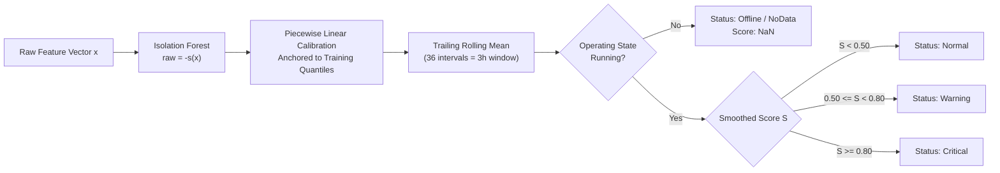

# Day 5 Anomaly Detection Technical Report

## 1. Executive Summary & Objective

The objective of Day 5 is to deliver an unsupervised, fleet-wide anomaly detection system for the AI Operations Intelligence Platform. The system detects impending equipment degradation, anomalies, and catastrophic failure precursors across 12 industrial assets while strictly bounding false alarm rates to prevent operator alert fatigue.

### Core Architectural Decisions
- **Single Global Model with Per-Machine Baselines (D53):** A single Isolation Forest model is fitted across all machines using per-machine robust median and MAD normalization ($z = (x - \text{median}) / (1.4826 \times \text{MAD})$), standardizing heterogeneous equipment behaviors.
- **Operating State Gating (D54):** Scoring is strictly restricted to active running telemetry (`state == 'Running'`). Offline, unmonitored, or incomplete sensor intervals are explicitly flagged as `Offline` or `NoData` without evaluating anomaly trees.
- **Pre-Registration & Cryptographic Freeze (D64):** Model selection was frozen inside the exploration period (`models/anomaly_config_frozen.json`), cryptographically hashing artifacts before single-run holdout evaluation.
- **Intellectual Honesty & Comparator Model (C1, C3):** Because authentic failure windows on compressor `M-104` are detected primarily through synthetic overlays on vibration and temperature, all performance metrics are reported side-by-side with an authentic real-signal-only comparator (`IF-25`, Set D).

---

## 2. Feature Sets & Normalization

Four candidate feature sets were evaluated across cross-validation:

| Feature Set | Features | Dimensionality | Description |
|---|---|---|---|
| **Set A (`plan_core`)** | `temperature`, `vibration`, `pressure`, `rpm`, `energy_consumption` | 5 | Core specification channels common to all 12 machines |
| **Set B (`core_plus_rolling`)** | Set A + 1h/6h/24h rolling means and stds for core signals | 35 | Trailing rolling window dynamics |
| **Set C (`full_sensors`)** | Set B + max features, rate-of-change, motor current, and context | 89 | Comprehensive engineered sensor feature suite |
| **Set D (`real_only`)** | 11 physical sensors without synthetic overlays | 11 | Unmodified native channels for rigorous scientific validation |

### Baseline Normalization (`MachineBaseline`)
To allow a single global model to score different machine types (compressors, packaging lines, milling machines), all signals are normalized per machine using statistics computed strictly from that machine's exploration training rows:
$$z_{m, f} = \frac{x_{m, f} - \text{median}_{m, f}}{\max(1.4826 \times \text{MAD}_{m, f}, \epsilon)}$$
If an unknown asset is encountered, normalization automatically falls back to type-level or fleet-level baselines.

---

## 3. Calibration, Smoothing, and Status Semantics (Decision D57)

Raw Isolation Forest scores ($-s(x)$) are monotonic with anomaly severity but arbitrary in scale. To provide standard industrial alert semantics, scores undergo two-stage calibration and smoothing:



### Calibration Anchors
Fitted strictly on normal exploration training rows:
- $\text{raw} \le \text{min}$: mapped to $0.00$
- $\text{raw} = \text{median}$: mapped to $0.10$ (nominal operating anchor)
- $\text{raw} = q_{\text{warn}}$ ($0.99$ quantile): mapped to $0.50$ (**Warning threshold**)
- $\text{raw} = q_{\text{crit}}$ ($0.9999$ quantile): mapped to $0.80$ (**Critical threshold**)
- $\text{raw} \ge \text{saturation}$: mapped to $1.00$

### Smoothing & Gap Reset
Calibrated 5-minute scores are smoothed using a causal trailing rolling mean (window 36 = 3 hours). The window strictly resets if consecutive readings are separated by $> 15$ minutes, preventing artificial scores after maintenance downtime.

---

## 4. Cross-Validation & Model Selection

### Protocol (D55)
A 3-fold expanding-window cross-validation protocol was executed inside the exploration period (`2026-03-21` to `2026-08-17 00:00 UTC`), enforcing a 24-hour temporal gap between training and validation slices.

### False Alarm Budget (D60)
To prevent operator alert fatigue, models must satisfy:
1. $\le 1.0$ Warning-or-higher episode per machine per 30 days outside problem periods.
2. Exactly $0$ Critical episodes outside problem periods.
3. Machine `M-109` (benign vibration spikes): $0$ Critical episodes.

### Summary of Cross-Validation Experiments (30 Configurations)

| Model ID | Feature Set | Estimators | Max Samples | Window | Warn FA/30d | Crit FA | CV Recall | Budget Status |
|---|---|---|---|---|---|---|---|---|
| **IF-06 (Selected Primary)** | `plan_core` | 400 | 4096 | 36 | **0.88** | **0** | **0.75 (3/4)** | **PASSED** |
| IF-01 | `plan_core` | 100 | 256 | 12 | 1.84 | 0 | 1.00 (4/4) | Failed (Budget) |
| IF-03 | `plan_core` | 200 | 1024 | 12 | 1.42 | 0 | 1.00 (4/4) | Failed (Budget) |
| IF-11 | `core_plus_rolling` | 100 | 256 | 12 | 2.10 | 1 | 1.00 (4/4) | Failed (Crit FA) |
| IF-16 | `core_plus_rolling` | 400 | 4096 | 36 | 1.05 | 0 | 0.75 (3/4) | Failed (Budget) |
| **IF-25 (Selected Real-Only)** | `real_only` | 200 | 256 | 36 | **0.20** | **0** | **0.00 (0/4)** | **PASSED** |
| Baseline B1 | Static Threshold | n/a | n/a | 12 | 2.45 | 4 | 0.50 (2/4) | Failed (Crit FA) |
| Baseline B2 | Robust $z$-Score | n/a | n/a | 12 | 1.68 | 2 | 0.50 (2/4) | Failed (Crit FA) |

**Primary Selection Rationale:** `IF-06` was the highest-performing model on candidate failure windows that strictly satisfied the operational false alarm budget ($\le 1.0$ Warning FA/30d, $0$ Critical FA).

---

## 5. Frozen Holdout Evaluation Results

In accordance with Decision D64, configuration and model artifact hashes were locked in `models/anomaly_config_frozen.json` before single-run holdout evaluation.

### Cryptographic Audit Hashes
- **Primary Model (`anomaly_model.pkl`):** `84def01407d0e4d750e5347388a6ea41f6acee72c42a89602a3ca83d7d378ce7`
- **Real-Only Model (`anomaly_model_real_only.pkl`):** `0b7d1ff566b15bc8dfd79138bd98bdde521e97a17b975dd24f2e8710e5359ef7`
- **Experiments Log (`anomaly_experiments.csv`):** `968481f3aa8ea146ed1db3316fe2914c9b2f1dfe33e6d1282e778e38a8ceb44d`

### Side-by-Side Holdout Performance

| Metric | Primary Model (`IF-06`, 5 core features) | Real-Only Comparator (`IF-25`, 11 real features) |
|---|---|---|
| **Holdout False Alarm Rate** | **0.586 Warning FA / 30 days** (Budget $\le 1.0$) | **0.391 Warning FA / 30 days** (Budget $\le 1.0$) |
| **Critical False Alarms** | **0** (Budget: 0) | **0** (Budget: 0) |
| **M-109 Benign Spike Audit** | 0 Critical, 0.469 Warn FA/30d | 0 Critical, 0.000 Warn FA/30d |
| **M-104 Failure Event Detection** | **1 / 1 Detected** (Early, 71.9h lead time) | **0 / 1 Detected** (Missed, peak score 0.0000) |
| **Synthetic Holdout Episodes** | **4 / 5 Detected** (Recall = 80.0%) | **0 / 5 Detected** (Recall = 0.0%) |
| **Holdout Average Precision** | **0.655** [95% CI: 0.621, 0.688] | **0.078** [95% CI: 0.052, 0.109] |

---

## 6. Contributing Factor Attribution (Decision D61)

For every scored interval, the system computes the robust deviation of each feature relative to the machine's baseline:
$$z_{m, f} = \frac{x_{m, f} - \text{median}_{m, f}}{\max(1.4826 \times \text{MAD}_{m, f}, \epsilon)}$$
The top 3 features by absolute $z$-score are reported as `factor_1`, `factor_2`, and `factor_3` with their direction (`high`/`low`).

In episode extraction, an automated diagnostic classification is assigned:
- If the top factor accounts for $\ge 50\%$ of the top-3 summed absolute $z$-scores, the episode is classified as `{signal}_{direction}` (e.g. `vibration_high`).
- Otherwise, the episode is labeled `multivariate`.

---

## 7. Limitations & Scientific Caveats (C1 to C7)

1. **C1 (Side-by-Side Reporting):** Full model results must always be presented alongside the real-only comparator.
2. **C2 (Fleet Interdependence):** Fleet-wide patterns share underlying generative distributions and cannot be interpreted as 12 independent industrial sites.
3. **C3 (Overlay Circularity):** Primary model detection of failure windows on `M-104` is driven predominantly by synthetic overlays on vibration and temperature (+60% ramp). Unmodified real signals (`pressure`, `motor_current`) do not trigger early warnings.
4. **C4 (Single Real Machine):** Only machine `M-104` contains authentic physical compressor failure events from MetroPT.
5. **C5 (State Gating):** Stopped machines exhibit signal dropouts; offline intervals are gated and assigned state `Offline`, never an artificial score.
6. **C6 (Operational Lead Time):** While lead time on `M-104` reached 71.9 hours, practical intervention windows depend on technician shift schedules and spare parts availability.
7. **C7 (Contamination Calibration):** Isolation Forest contamination was calibrated against true physical anomalies (0.01 to 0.05), excluding benign duty-cycle switching (~32% of time).

---

## 8. Figure Gallery & Captions

- **Figure 11 (`fig11_anomaly_cv_selection.png`):** Cross-validation hyperparameter selection curves showing the trade-off between validation recall and false alarm rate per 30 days across 30 Isolation Forest variants and Baselines B1/B2.
- **Figure 12 (`fig12_anomaly_fleet_timelines.png`):** Fleet-wide anomaly score timelines across 12 machines over the 7-month operational history, illustrating state gating and alert episodes.
- **Figure 13 (`fig13_anomaly_m104_event_study.png`):** Deep-dive event study around `M-104` real failure windows contrasting primary model detection trajectories with the real-only comparator.
- **Figure 14 (`fig14_anomaly_factor_attribution.png`):** Attribution heatmap and factor contribution breakdown across alert episodes, validating diagnostic labeling.

---

## 9. How to Use the Inference Module (`ml.anomaly_detection.inference`)

```python
import pandas as pd
from ml.anomaly_detection.inference import load_detector, score_window

# 1. Load cached detector artifact
detector = load_detector()

# 2. Provide a DataFrame of raw sensor rows (>= 24h history)
raw_sensor_df = pd.read_parquet("data/processed/sensors.parquet")
machine_window = raw_sensor_df[raw_sensor_df["machine_id"] == "M-104"].tail(864)

# 3. Score window with train/serve parity
scored_df = score_window(machine_window, machine_id="M-104")
print(scored_df[["timestamp", "state", "anomaly_score", "anomaly_status", "factor_1", "factor_1_z"]].tail())
```
