# Data Engineering Pipeline Specification

**Project:** AI Operations Intelligence Platform  
**Phase:** Day 03 (Data Engineering & Feature Store)  
**Status:** COMPLETE / VERIFIED  

---

## 1. Pipeline Architecture

The pipeline processes raw industrial telemetry, work orders, factory production records, and enterprise retail transactions through an auditable, non-destructive, and leakage-safe data transformation workflow.

```mermaid
flowchart TD
    subgraph RawSources["Raw Unified Datasets (data/raw/unified/)"]
        R1[machines.csv]
        R2[sensors_raw.csv]
        R3[maintenance_raw.csv]
        R4[production_raw.csv]
        R5[business_daily_raw.csv]
        R6[business_transactions_raw.csv]
    end

    subgraph PreValidation["Pre-Cleaning Validation"]
        V1[validate_all before]
    end

    subgraph CleaningStage["Data Cleaning & Non-Destructive Filtering"]
        C1[clean_sensors<br/>5-min Grid, Impute <=15m, Tier 1 Hard Limits]
        C2[clean_other<br/>Maintenance, Production, Machines, Business Daily]
        C3[clean_transactions<br/>Flag Cancellations, Guests, Extreme Qty, Separate Rejections]
    end

    subgraph OutliersLabels["Outlier Flagging & Ground Truth"]
        O1[flag_outliers<br/>Tier 2 Trailing Robust Z > 6.0]
        L1[generate_anomaly_eval_labels<br/>MetroPT & Synthetic Ground Truth]
        P1[run_preservation_checks<br/>Verify 0 Real Anomalies Destroyed]
    end

    subgraph FeatureStore["Feature Engineering Store"]
        F1[engineer_sensor_features<br/>Trailing Rolling, Slopes, Maintenance As-Of]
        F2[compute_daily_retail_features & product_demand_daily]
        F3[integrate_operations_dataset<br/>Daily Machine Aggregates & Business KPIs]
    end

    subgraph PostValidation["Validation & Quality Audit"]
        V2[validate_all after<br/>Zero Errors Asserted]
        LK[audit_temporal_leakage<br/>Rules L1 - L5 Enforced]
        QR[generate_quality_report<br/>quality_report.json & data_quality_report.md]
    end

    subgraph ProcessedOutputs["Processed Datasets (data/processed/)"]
        O_SF[sensor_features.parquet]
        O_OD[operations_dataset.parquet & .csv]
        O_SN[sensors.parquet]
        O_LB[anomaly_eval_labels.parquet]
        O_TR[business_transactions.parquet]
        O_RJ[business_transactions_rejected.parquet]
        O_BF[business_features_daily.parquet]
        O_PD[product_demand_daily.parquet]
        O_MC[machines.parquet]
        O_MN[maintenance.parquet]
        O_PR[production.parquet]
        O_BD[business_daily.parquet]
    end

    subgraph DatabaseLoading["PostgreSQL Production Storage"]
        DB[(PostgreSQL 16<br/>COPY inside Atomic Transaction)]
    end

    RawSources --> PreValidation
    PreValidation --> CleaningStage
    CleaningStage --> OutliersLabels
    OutliersLabels --> FeatureStore
    FeatureStore --> PostValidation
    PostValidation --> ProcessedOutputs
    ProcessedOutputs --> DatabaseLoading
```



---

## 2. Pipeline Execution Steps & Architecture Policies

| Step # | Module / Function | Architectural Policy | Description |
| :--- | :--- | :--- | :--- |
| **1. Ingest** | `ml.preprocessing.ingest` | **D34, D37** | Typed ingestion of raw CSVs into memory-tracked DataFrames with UTC timestamps. Supports `--sample` mode (2 machines, 45 days). |
| **2. Validate (Before)** | `ml.preprocessing.validate` | **D30** | Baseline validation checking duplicates, physical bounds, timestamp monotonicity, and cross-table foreign keys. |
| **3. Clean Sensors** | `ml.preprocessing.clean_sensors` | **D30, D31, D38** | Reindexes 5-minute grid; sets impossible values to `NaN` (`is_sensor_fault = True`); imputes gaps $\le 15$ min (`is_imputed = True`); marks first 24h as `is_warmup`. |
| **4. Clean Other Tables** | `ml.preprocessing.clean_other` | **D30, D36** | Normalizes maintenance failure types, cleans machine production bounds, and verifies daily business consistency. |
| **5. Tier 2 Outliers** | `ml.preprocessing.outliers` | **D30** | Computes trailing 24h robust $z$-scores ($|Z| > 6.0$). Flags rows without modifying values (`is_outlier_flag = True`). Verifies 4 anomaly preservation criteria. |
| **6. Clean Transactions** | `ml.preprocessing.clean_transactions` | **D35** | Splits transactions into kept records and invalid rejections; flags cancellations, guest checkouts, non-product codes, and extreme orders ($\ge 10,000$). |
| **7. Ground-Truth Labels** | `ml.preprocessing.labels` | **D33** | Generates real MetroPT failure windows, 72h precursor windows, and synthetic incident labels into a completely separate file. |
| **8. Sensor Features** | `ml.preprocessing.features_sensor` | **D32, D39, D41** | Computes 1h, 6h, 24h trailing rolling statistics, 24h least-squares slopes, running ratios, and strictly past ($D+1$) maintenance indicators. |
| **9. Daily Integration** | `ml.preprocessing.integrate` | **D29, D40** | Computes company-level daily retail KPIs, product demand across top 50 SKUs, and daily machine-level `operations_dataset` for complete 288-interval days. |
| **10. Validate (After)** | `ml.preprocessing.validate` | **L1–L5** | Runs post-cleaning validation; asserts zero errors remain; audits datasets for temporal leakage and grain uniqueness. |
| **11. Atomic Persistence** | `ml.preprocessing.pipeline` | **D34** | Writes all 12 Parquet and CSV outputs atomically (via temporary file swap) to prevent partial file writes. |
| **12. Quality Audit Report** | `ml.preprocessing.report` | **D30, D35** | Generates structured `quality_report.json` and human-readable `docs/data_quality_report.md`. |
| **13. Database Loader** | `scripts.load_to_db` | **D26, D36** | Optional high-speed PostgreSQL `COPY` inside a single atomic transaction with foreign-key ordering and count verification. |

---

## 3. Temporal Leakage Prevention Rules (L1–L5)

To guarantee that machine learning models developed on Day 5 and Day 6 achieve true out-of-sample validity, the pipeline strictly adheres to five non-negotiable temporal leakage rules:

1. **L1 (Strictly Trailing Rolling Windows):**
   - All rolling aggregations (means, standard deviations, max values) and least-squares trend slopes use strictly trailing windows ($t' \le t$).
   - Centered windows and negative shifts (`shift(-n)`) are strictly prohibited across the entire codebase.
2. **L2 (Strictly Past Maintenance Events):**
   - A maintenance event occurring on date $D$ is visible to rolling features strictly on date $D + 1$ (as-of join).
   - Prevents look-ahead bias regarding unscheduled corrective repairs.
3. **L3 (No Global Statistics in Features):**
   - Features never incorporate dataset-wide means, variances, min/max values, or global quantiles.
   - Per-machine normative baselines are deferred to Day 5, where they will be fit strictly on the early training partition.
4. **L4 (Ground-Truth Label Isolation):**
   - Ground truth targets (`in_failure_window`, `in_precursor_window`, `failure_window_id`, `episode_type`, `episode_id`) reside exclusively in `anomaly_eval_labels.parquet`.
   - Simulation metadata (`status`, `scenario`, `data_origin`, `ai4i_type`) is strictly forbidden in `sensor_features.parquet` and `operations_dataset.parquet`.
5. **L5 (Bounded Forward Imputation):**
   - Gaps $\le 3$ intervals (15 minutes) are forward-filled or linearly interpolated and explicitly flagged via `is_imputed = True`.
   - Gaps exceeding 15 minutes remain `NaN` with `is_gap = True`, ensuring ML models learn to handle genuine telemetry dropout.

---

## 4. Processed Output File Contract

All processed artifacts are written to `data/processed/`:

| File Name | Format | Grain | Key Columns | Approx. Rows | Description |
| :--- | :--- | :--- | :--- | :--- | :--- |
| `machines.parquet` | Parquet | Machine | `machine_id` | 12 | Cleaned equipment master catalog. |
| `sensors.parquet` | Parquet | Machine $\times$ 5 min | `machine_id`, `timestamp` | ~800,000 | Cleaned 5-min sensor grid with Tier 1 nullifications and Tier 2 outlier flags. |
| `sensor_features.parquet` | Parquet | Machine $\times$ 5 min | `machine_id`, `timestamp` | ~800,000 | Comprehensive sensor feature store (89 features: rolling stats, slopes, maintenance as-of). |
| `maintenance.parquet` | Parquet | Work Order | `maintenance_id` | 42 | Normalized equipment maintenance interventions. |
| `production.parquet` | Parquet | Machine $\times$ Day | `machine_id`, `date` | 2,556 | Machine-level daily production yield, targets, scrap, and downtime. |
| `business_daily.parquet` | Parquet | Day | `date` | 213 | Factory-level daily production, energy, downtime, and inventory balances. |
| `business_transactions.parquet` | Parquet | Invoice Line | `transaction_id` | ~540,000 | Clean kept retail transactions with audit flags and `revenue_clean`. |
| `business_transactions_rejected.parquet` | Parquet | Invoice Line | `transaction_id` | ~2,500 | Rejected retail lines (non-positive prices, unresolvable keys). |
| `business_features_daily.parquet` | Parquet | Day | `date` | 213 | Daily company-level order velocity, AOV, returns, and sales growth. |
| `product_demand_daily.parquet` | Parquet | Product $\times$ Day | `date`, `product_id` | ~10,650 | Daily unit and revenue demand across top 50 retail products. |
| `operations_dataset.parquet` | Parquet | Machine $\times$ Day | `machine_id`, `date` | 2,556 | Primary cross-domain analytical dataset combining telemetry, production, and business KPIs. |
| `operations_dataset.csv` | CSV | Machine $\times$ Day | `machine_id`, `date` | 2,556 | Canonical CSV representation of the operations dataset for cross-platform EDA. |
| `anomaly_eval_labels.parquet` | Parquet | Machine $\times$ 5 min | `machine_id`, `timestamp` | ~800,000 | Isolated ground-truth evaluation labels for unsupervised anomaly detection. |
| `feature_catalog.csv` | CSV | Feature | `name` | 89 | Metadata catalog documenting every engineered feature, formula, and leakage rule. |
| `quality_report.json` | JSON | Pipeline Run | N/A | 1 | Complete machine-readable audit report of all pipeline transformations. |

---

## 5. Execution Instructions

The pipeline can be executed via `Makefile` targets or directly via Python CLI commands:

### Running via Makefile
```bash
# 1. Run pipeline in fast sample mode (M-103 & M-104, trailing 45 days, skip db)
make pipeline-sample

# 2. Run full fleet pipeline (all 12 machines, 214 days, skip db)
make pipeline

# 3. Load processed data into PostgreSQL database
make db-load

# 4. End-to-end execution: prepare raw data, run pipeline, and load database
make data

# 5. Run automated test suite
make test

# 6. Run linting and code quality checks
make lint
```

### Running via Python CLI
```bash
# Activate virtual environment
source .venv/bin/activate  # On Linux/macOS
# or: .\.venv\Scripts\Activate.ps1  # On Windows PowerShell

# Fast sample mode (approx. 10-15 seconds)
python scripts/run_pipeline.py --sample --skip-db

# Full production run
python scripts/run_pipeline.py --skip-db

# Step-isolated debugging (e.g. up to ingestion or pre-validation)
python scripts/run_pipeline.py --only ingest
python scripts/run_pipeline.py --only validate_before

# Database loader (dry run mode)
python scripts/load_to_db.py --dry-run

# Database loader (active COPY transaction)
python scripts/load_to_db.py
```
